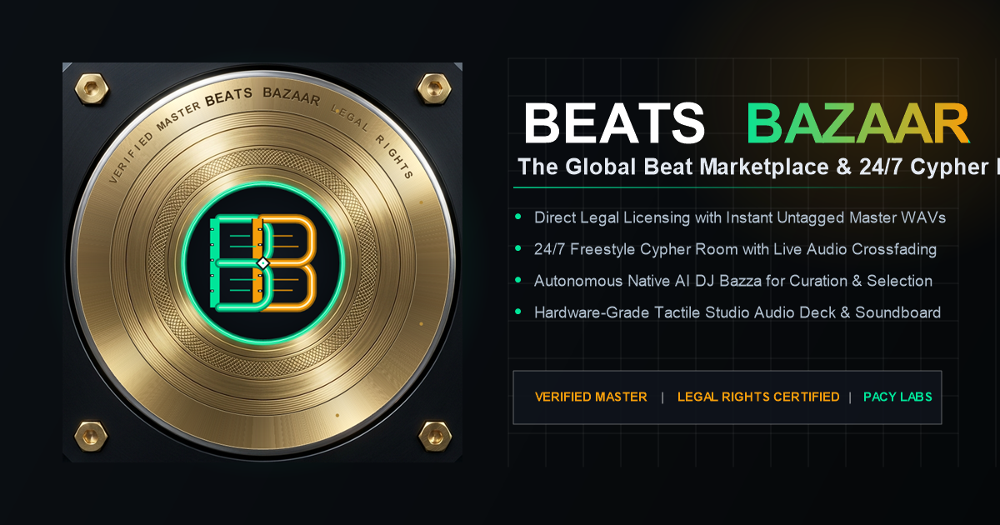
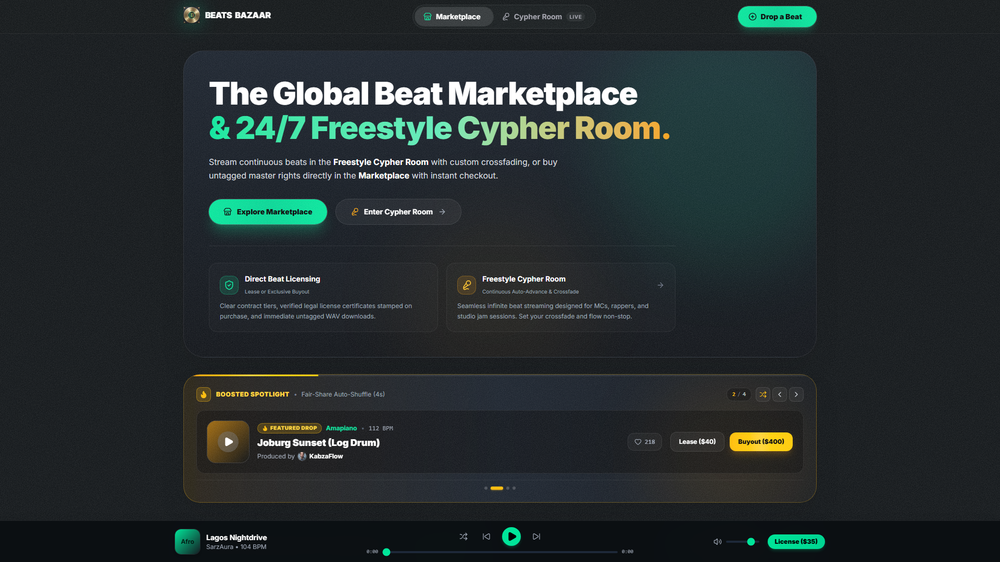
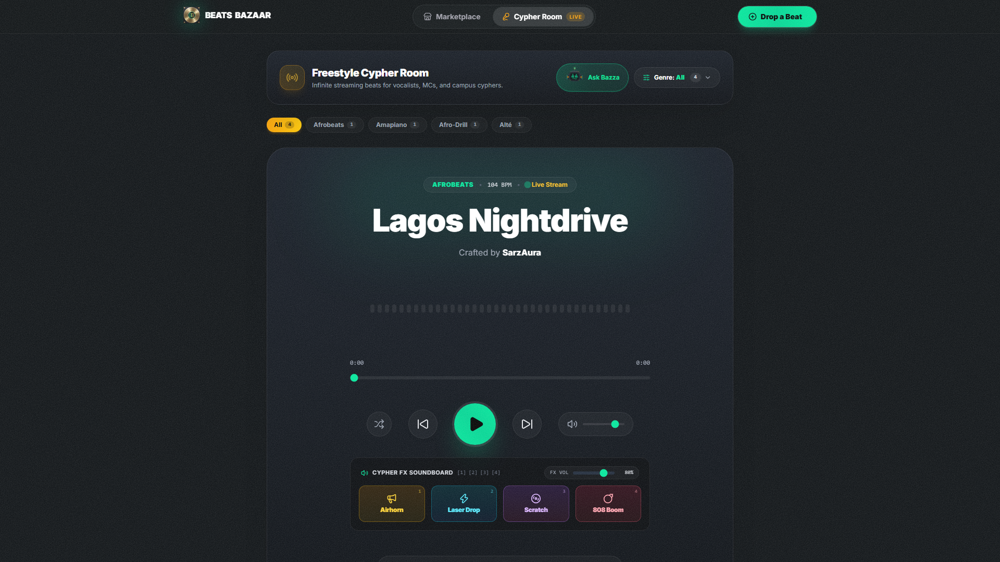
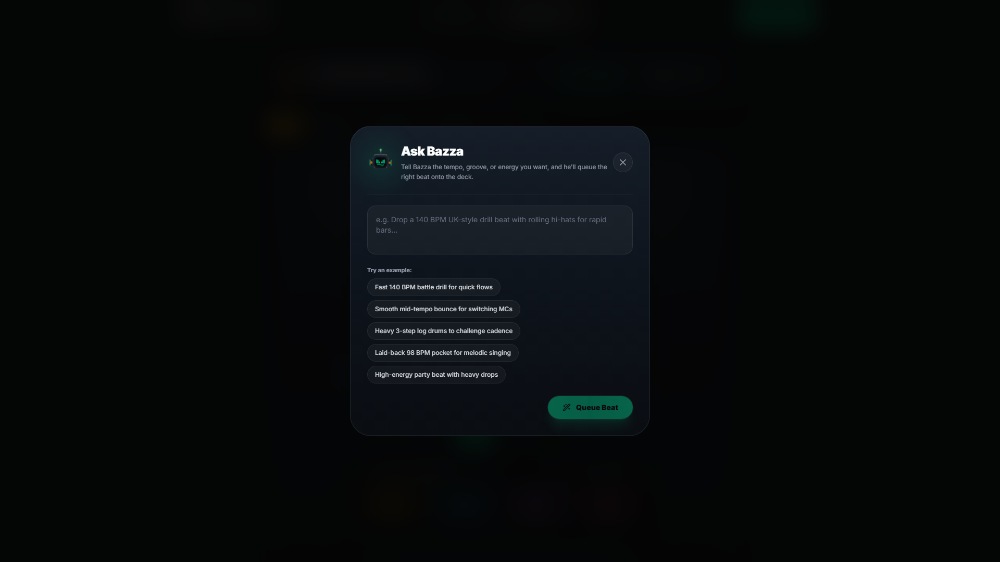
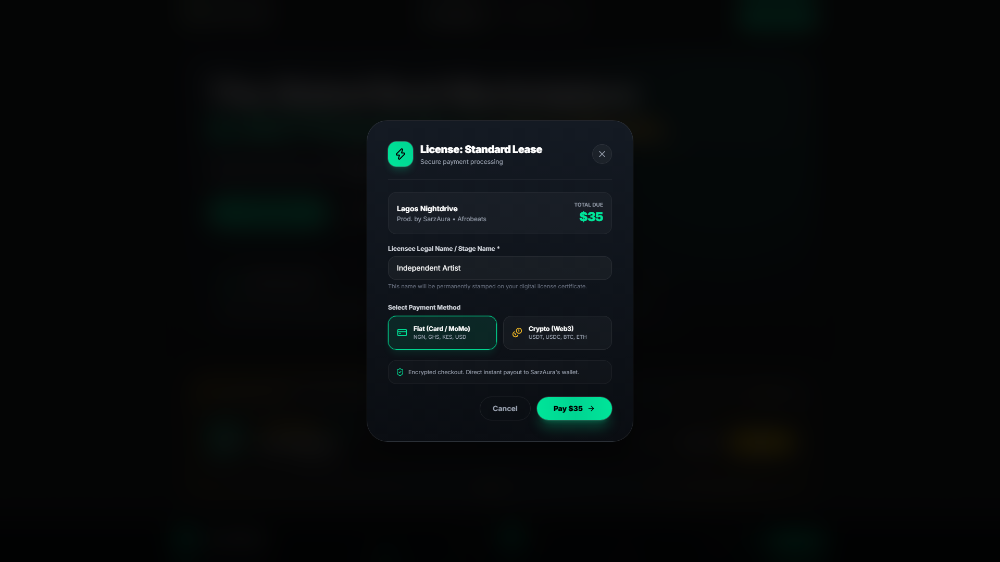

<div align="center">

  

  # BEATS BAZAAR
  ### The Global Beat Marketplace & 24/7 Freestyle Cypher Room

  [](https://beatsbazaar.vercel.app)
  [](https://nextjs.org/)
  [](https://react.dev/)
  [](https://ai.google.dev/)
  [](https://developer.mozilla.org/en-US/docs/Web/API/Web_Audio_API)

</div>

---

## Overview

**Beats Bazaar** is a hardware-grade music technology platform that unites independent beat commerce with real-time cypher performance. Built for music producers, rappers, vocalists, and MCs, it solves the discovery and monetization bottleneck for underground beatmakers while providing artists an uninterrupted, ad-free freestyle environment.

### The Problem It Solves
1. **Broken Beatmaker Monetization:** Talented producers struggle with discovery, predatory contracts, and reliance on word-of-mouth.
2. **Freestyle Ad-Fatigue:** Vocalists and MCs practicing cyphers rely on YouTube to find beats, constantly getting derailed by mid-roll video advertisements and algorithm resets.

Beats Bazaar unites these two worlds into a singular continuous experience: producers showcase and sell original instrumentals with verified legal licenses, while artists get an infinite, commercial-free 24/7 audio cypher room to test their flows.

---

## Core Product Pillars

### 1. Verified Master Beat Marketplace
Browse, audition, and license original production across Afrobeats, Amapiano, Afro-Drill, Trap, Boom Bap, and R&B. Features dynamic genre filtering, protected watermarked audio streaming, likes, producer profiles, and sponsored spotlight boosts.

<div align="center">
  
</div>

---

### 2. 24/7 Live Freestyle Cypher Room & DJ Turntables
An interactive, hardware-inspired dual-turntable audio deck equipped with smooth gain crossfading, real-time Web Audio API waveform visualizer, and an interactive crowd soundboard (airhorn, laser drop, multi-phase turntable vinyl scratch, and 808 sub boom) with dedicated real-time user volume control.

<div align="center">
  
</div>

---

### 3. Bazza: Resident AI Crate Selector (Powered by Google Gemini)
Bazza is an intelligent, street-smart music director with an animated hardware mascot. 
* **In the Marketplace:** Artists describe their desired sound, tempo, mood, or artist reference (e.g., Burna Boy, Asake, Travis Scott) in natural language. Bazza inspects the live catalog schema and recommends the exact beat to license with authentic music-production commentary.
* **In the Cypher Room:** MCs request a tempo or rhythm change, and Bazza automatically queues the matching instrumental directly onto the turntable deck.
* **Resilient Architecture:** Features a local deterministic heuristic matching fallback to guarantee continuous operation even during external network outages.

<div align="center">
  
</div>

---

### 4. Instant Digital Rights Licensing & Verification
Artists can purchase **Standard Lease** or **Exclusive Buyout** rights, instantly generating legally structured digital license certificates with unique cryptographic verification tokens and immediate uncompressed master WAV audio downloads.

<div align="center">
  
</div>

---

## Technical Stack

| Layer | Technologies |
|---|---|
| **Framework** | Next.js 16 (App Router, Turbopack, React Server Components) |
| **Frontend & UI** | React 19, Tailwind CSS 4, Lucide Icons |
| **Audio Processing** | Web Audio API (Stereo Crossfading, Dynamic Biquad Filters, FFT Frequency Analyser, Multi-Phase Waveform Synthesizer) |
| **Artificial Intelligence** | Google Gemini (`gemini-3.8-flash` via `@google/genai` SDK with strict JSON schema constraints) |
| **Licensing Engine** | Cryptographic hash generation, token attribution, and client-side certificate generation |
| **Deployment** | Vercel Serverless Edge Platform |

---

## Getting Started

### Prerequisites
* Node.js 18.18 or later
* npm, yarn, or pnpm

### Installation

1. Clone the repository:
   ```bash
   git clone https://github.com/Kryptopacy/beats-bazaar.git
   cd beats-bazaar
   ```

2. Install dependencies:
   ```bash
   npm install
   ```

3. Configure environment variables:
   ```bash
   cp .env.example .env.local
   ```
   Add your Google Gemini API key to `.env.local`:
   ```env
   GEMINI_API_KEY=your_gemini_api_key_here
   ```

4. Start the development server:
   ```bash
   npm run dev
   ```
   Open [http://localhost:3000](http://localhost:3000) in your browser.

### Production Build
```bash
npm run build
npm start
```

---

## Architecture & Process Documentation

This project was built following the Devpost Learn Skill Pack specifications:

* [`devpost/scope.md`](devpost/scope.md): Initial scoping, core kernel, and proof-of-concept boundaries.
* [`devpost/prd.md`](devpost/prd.md): Complete product requirements document, states, and user journeys.
* [`devpost/spec.md`](devpost/spec.md): Technical architecture blueprint and data contracts.
* [`devpost/checklist.md`](devpost/checklist.md): Slice-by-slice build and verification log.
* [`devpost/app-map.html`](devpost/app-map.html): Interactive code tour and component dependency graph.

---

## License

MIT License. Built for the Devpost Build With AI: Basics Hackathon.
